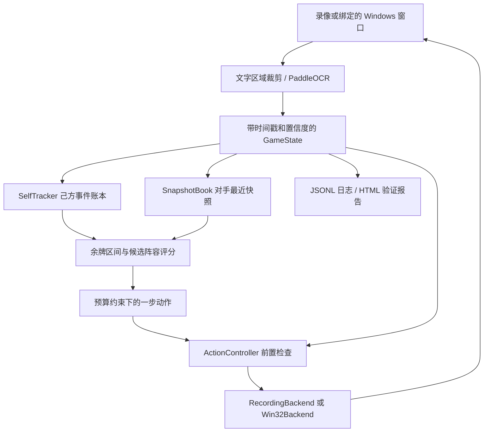

# 开发架构

## 数据与执行路径

运行时仅从 PaddleOCR 输出文字和数字获取语义；裁剪、放大和区域拼图属于 OCR 预处理。没有英雄卡面分类器、棋子外观检测器或视觉大模型。开发过程对抽帧做人工审阅，用于验证坐标与建立真值，不能计为运行时自动识别。

## 模块

| 文件 | 职责 |
|---|---|
| `models.py` | 状态、英雄、规则、阵容、动作及确认结果的数据契约 |
| `perception.py` | PaddleOCR 3.x 适配、区域 OCR、数字与英雄名解析、文字阶段识别 |
| `video.py` | 录像信息、按实际帧提取、用户时间标注（仅评估真值） |
| `rules.py` | 严格规则配置校验和英雄名/别名匹配 |
| `pool.py` | 未知星级、陈旧快照和未核实规则下的余牌估计 |
| `strategy.py` | 阵容评分、切换门槛、逐动作预算与停止条件 |
| `tracking.py` | 己方初始快照、确认事件、总副本与位置分离 |
| `context.py` | 有来源的视角上下文、导航失效与新鲜 OCR 恢复 |
| `control.py` | 串行输入、前置条件、动作后确认、暂停与重同步 |
| `scouting.py` | 有限回合时间预算内的按玩家/位置轮询 |
| `session.py` | 会话阵容计划、回合预算、对手快照协调 |
| `runtime.py` | 窗口绑定、前台校验、画面年龄与实时循环 |
| `storage.py` / `reporting.py` | 可重放日志和独立 HTML 报告 |
| `calibration.py` | 无网络的本地点击坐标和 OCR 区域编辑器 |

## 三类不确定性

1. **识别不确定性**：读不到英雄、价格、阶段或玩家身份时，保持 unknown；不强制模糊匹配。
2. **观测不完整**：只看到部分对手，或星级只有图标时，保留范围与时间戳。不能把未观察当空。
3. **规则不确定性**：原版画之灵和返场不一定一致；配置来源保留 `tft_reference_unverified_jcc`，阵容分数是启发式，不是胜率。

## 己方账本

纯 OCR 在本录像中不能直接读星级图标。己方总副本可从经核对的初始快照开始，以确认购买、普通合成等事件追踪；是否允许普通合成推断通过 `ordinary_merges` 声明。位置未知不会伪造落点。备战席剩余空间使用可确认的保守下界。

该机制不等于自动识别了初始37格。没有完整初始观测时保持不完整；出现未跟踪手动操作、特殊生成或不一致观测应使账本失效并要求重新同步。实现中的支持程度见验证文档，不能把仿真通过当成完整实战能力。

## 交易确认

- 买牌使用当下商店 OCR 售价，英雄基础费用仅用于牌库分层。
- 刷新后五张牌可能与之前一样，不能依靠名字变化作为唯一确认。
- 操作必须绑定状态版本和窗口；鼠标点击前再查前台窗口。
- 上一次动作 pending 时禁止发送下一个动作；超时暂停，不盲重试。
- 一般空白槽保留 unknown；确认交易后的空槽可以由事件账本记录，必须有独立扣款和局部商店证据。
- 1–2 秒是目标节奏，模型启动、购买确认、未知重试允许延长；实测延迟单独报告。
- 刷新待确认期间不能用旧商店已购空槽填补新商店漏识别。回合候选期暂停新增消费，防止预算重置漏算。
- 单帧回合漏读暂停空槽缓存使用而非销毁；恢复同一可信回合后可继续，向前回合或刷新切换代次。

## 侦察

每回合只分配有限时间，跨回合保留游标；自己的决策与侦察共享单一输入控制器。棋盘读取默认要求静态准备阶段，不能把战斗中移动单位当作固定格持牌。每次读详情前关闭旧面板，并等待关闭证据；名字相同不是新点击成功证据。玩家身份使用明确 OCR 名称映射，不能按血量榜第几行认定身份。

## 当前扩展点

完整自主阵容部署、可信满备战清理、装备使用、特殊升星/赠牌机制、无文字阶段的连续时序推断，需要进一步实现与验证。操作类型在契约中存在不代表对应实时动作已经支持。实际支持以控制器的动作守卫、测试和真实素材报告为准。
